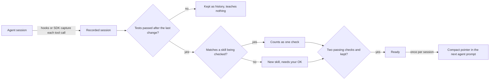
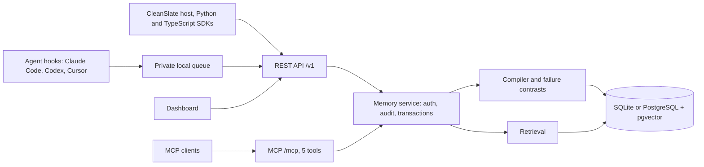

# How MuscleMemory works

MuscleMemory watches your agent work. When a task really succeeds, it
learns how the task was done. The next time a similar task comes up, it hands the
agent a short pointer: which files to change, how to check the result, and what
to avoid. The agent still decides what to do.

## The loop



1. **Capture.** Hooks for Claude Code, Codex and Cursor, the CleanSlate host
   adapter, or the Python and TypeScript SDKs record each tool call: the tool,
   its arguments, its result and its exit status. Secrets are redacted before
   anything is stored.
2. **Verify.** When a session stops, the hook checks one thing: did a test
   command pass after the last code change? Edits through the edit tools count,
   and so does any shell command that changed project files (the hook compares
   which files differ from version control before and after it). If any tool
   call is missing from the capture, or no test ran after the last change, the
   session teaches nothing.
3. **Learn or check.** A passing session that changed the same files as a skill
   counts as one independent check for that skill, whichever agent ran it and
   whichever tool made the change. The original agent's read-only commands
   (`cat`, `sed -n`, `grep`, `git diff`) need not be repeated.
   Otherwise MuscleMemory compiles a new skill from it. The session a skill was
   learned from can never count as one of its checks.
4. **Approve.** Skills learned automatically wait for a person's OK. In the
   dashboard they show as "Needs your OK" with Keep and Delete buttons. Skills
   created on purpose through the API count as approved.
5. **Ready.** A skill is handed to agents only when it is kept, has at least two
   passing checks, has a smoothed reliability of at least 0.65, has been
   validated in the last 90 days, and needs only tools and permissions the
   agent actually has. Changing a file is one ability whatever the tool is
   called (Codex's patch, Claude Code's Edit and Write, Cursor's Write), so a
   skill learned with one agent is handed to the others; every other tool must
   match exactly.
6. **Recall.** At the start of a session (Cursor: at its first tool result) the
   hook asks for the best match and adds one compact pointer to the agent's
   prompt. A session gets the same skill at most once and at most two pointers in
   total. When nothing fits, MuscleMemory adds nothing.

## What a skill stores

- **Steps** compiled from the successful session, with dead ends and failed
  branches removed. Steps keep their dependency graph.
- **Files read and files changed**, the commands run, and the **test command**
  that proved the result.
- **Applicability conditions**: the capabilities, permissions and environment
  values it needs. Recall skips a skill when any condition is unknown or unmet.
- **Watch-out and recovery notes**, written in plain English from failed steps,
  retries and failure contrasts (below).
- **Evidence**: the source session, every check with its measurements, and the
  revision history.

The pointer sent to an agent is compact JSON, capped at 350 tokens by default. It
contains the title, changed files, the test command, up to four before-and-after
snippets of the key edits, files to read first, preconditions, one watch-out note,
the permissions needed and a notice that the agent must check the current files and
keep its normal approvals. When it is too long, whole optional fields and then edit
snippets are dropped; code is never cut mid-string. The full skill is available through `musclememory_inspect`.

## Learning from failures

- **Failure contrasts.** When a skill is learned, MuscleMemory looks for failed
  sessions in the same workspace that took the same sequence of actions. It
  compares the action shapes (key names and types, never values) and records
  which steps only the working run had, which only the failed run had, and
  which were called differently. These become watch-out and recovery notes, and
  steps unique to the working run are marked critical.
- **One failed check flags a skill.** If a later check fails, the skill is
  flagged and stops reaching agents until a new revision is learned and checked.
- **Optional refinement.** If you set `MM_BOUNDARY_LLM_URL`, the notes can be
  refined by an HTTPS model endpoint. Only value-free text is sent: commands
  become "a command" and file names become "a file".

## Retrieval

Retrieval picks candidates from several cheap signals, then ranks them.

| Signal | How it works |
| --- | --- |
| Exact | A file path or command from the task appears verbatim in a stored skill. |
| Keywords | BM25 (k1 1.5, b 0.75) over the task, title, files and test command. |
| Meaning | Local MiniLM embeddings (`all-MiniLM-L6-v2`, 384 dimensions), cosine similarity with a floor of 0.40. |
| Recent | Recently updated skills join the pool so new ones are not missed. |

The lists are combined with reciprocal rank fusion (k = 60). A candidate must
reach a relevance of 0.25. The final score is:

```text
score = 0.75 × max(exact match, fused rank) + 0.20 × reliability + 0.05 × freshness
```

Reliability is Laplace-smoothed: (successes + 1) / (checks + 2). Freshness falls
from 1 to 0 over the 90-day freshness window. Related skills are linked when one
produces a file another reads; a file touched by more than 8 skills (lockfiles,
READMEs) creates no links. Default recall makes no model calls.

## Components



One Python service (FastAPI) serves the REST API, the MCP endpoint with five
tools (`recall`, `observe`, `learn`, `evaluate`, `inspect`) and the dashboard.
Hooks write each event to a private local queue first, so a capture survives a
stopped server and is delivered later with `musclememory hooks flush`.

## Storage

- **SQLite** is the default, in `~/.musclememory/memory.db`. SQLite has no vector
  index, so each server process keeps the current vectors of a workspace as one
  normalized matrix plus an in-memory keyword index. It rebuilds them when skills
  are added or removed. A recall is then a matrix product and a few array lookups.
- **PostgreSQL with pgvector** stores real vectors of any size. A partial HNSW
  index exists for each embedding dimension in use (128 and 384 are created by
  the migrations; `musclememory migrate` adds one for the configured dimension).
  Keyword candidates come from PostgreSQL full-text search.
- Migrations are explicit: run `musclememory migrate`. Recorded sessions expire
  after 30 days by default; skills and their evidence stay until you delete them.

## Security

- **API keys** are random 256-bit values, stored only as SHA-256 digests and
  shown once. Each key grants `read`, `write`, `delete` or `admin` on specific
  workspaces (namespaces) of one tenant. Every query filters by tenant and
  workspace before returning data. There is no anonymous access.
- **Dashboard sign-in** can use a one-time code from `musclememory dashboard`.
  The code is stored hashed, works once and expires after 5 minutes; the browser
  swaps it for a dashboard key.
- **Redaction** removes values under secret-looking keys (tokens, passwords, API
  keys) before storage, and secrets cannot become skill parameters.
- **Agent context is untrusted.** Pointers tell the agent to check the current
  files and follow its normal permissions. MuscleMemory never runs anything.
- The server sends a strict Content Security Policy, rejects unknown hosts and
  origins, limits request bodies to 2 MiB and rate-limits each key.

## What it does not do

- It does not replay actions. Agents get guidance, not commands to execute.
- It does not call a model by default. Embeddings run locally; the only remote
  calls are ones you configure (`MM_EMBEDDING_URL`, `MM_BOUNDARY_LLM_URL`).
- It does not learn from sessions with missing tool calls, from sessions where
  no test passed after the last change, or from the session being checked.
- It does not hand a skill to agents before two independent checks and, for
  automatic skills, your OK.
