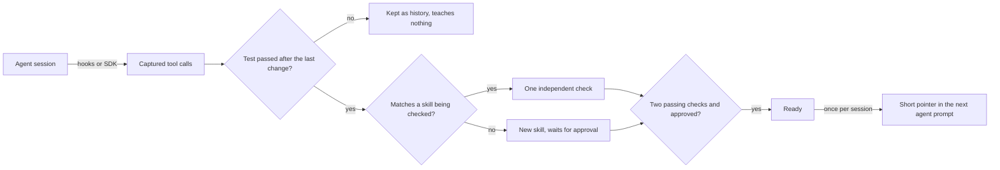

# MuscleMemory: Verified Procedural Memory for Coding Agents

**TheWariend** · Version 1.0 · October 2026 · Apache-2.0
Code and data: [github.com/TheWariend/MuscleMemory](https://github.com/TheWariend/MuscleMemory)

## Abstract

Coding agents start every session from zero. They rediscover which files matter, how
the tests run and which approaches fail, and they pay for that rediscovery in tokens,
tool calls and time. MuscleMemory is an open-source procedural memory service that
records how an agent completes a task, keeps only work that was proven by a passing
test after the last code change, and hands a short pointer to the next agent that
faces a similar task. A learned skill reaches agents only after two separate passing
checks and a person's approval. Failed attempts are
turned into plain "watch out" notes instead of being thrown away.

On 18 real Codex sessions across three repair tasks, MuscleMemory cut input tokens by
25.5%, tool calls by 30.4% and wall time by 28.2%, with every task still passing an
independent check. The skills were learned by a different model than the one that
used them. In an early run with Claude Code and Sonnet 5.5, using skills that Codex had
learned, input tokens fell by 43.5% and tool calls by 30% over four pairs. Recall makes
no model calls and took 13 ms at the median. This paper
describes the design, the trust rules, the retrieval method and the evaluation, and
it states what the results do not show.

## 1. The problem

A coding agent that fixes a bug in a project on Monday knows nothing about it on
Tuesday. The second session reads the same files, runs the same exploratory commands
and sometimes repeats the same mistakes. Most of a session's cost is this kind of
orientation, not the edit itself.

Saving context between sessions is easy. Saving the *right* context is not. An agent's
history is full of dead ends, retries and guesses. A memory that replays everything
an agent did will also replay its mistakes, and a memory that trusts a single
successful run will generalise from luck. Three questions follow:

1. **When has an agent actually learned something?** A session that ended is not a
   session that worked.
2. **When should a learned procedure be trusted?** One success can be a coincidence.
3. **When should memory stay quiet?** Handing the wrong procedure to an agent costs
   more than handing it nothing.

MuscleMemory answers each of these with an explicit rule rather than a model's
judgement.

## 2. Design principles

- **Learn only from verified success.** A session teaches something only when a test
  command passed after the last code change and every tool call was captured.
- **Trust needs independent checks.** A skill is handed to agents only after two later
  sessions pass with it. The session it was learned from never counts.
- **People stay in charge.** Every skill waits for a person's OK, and agents cannot give it.
- **Guidance, never replay.** Agents receive a short pointer: files, the key edits,
  the test and what to avoid. They still read the current code and ask for approval as usual.
  For coding, MuscleMemory runs nothing. In the browser, an agent can ask it to carry out
  a proven skill step by step with checks; the agent always does the final submit.
- **Quiet by default.** If no skill clears the bar, nothing is added and the agent
  pays no extra tokens.
- **Failures are data.** A failed attempt next to a working one shows what to avoid.
- **Local and open.** SQLite and a small on-device embedding model by default, no
  account and no outside calls. PostgreSQL with pgvector for teams. Apache-2.0.

## 3. System overview



One Python service (FastAPI) exposes a REST API, a Model Context Protocol endpoint
with five tools (`recall`, `observe`, `learn`, `evaluate`, `inspect`) and a dashboard.
Agents connect in one command: `musclememory connect claude`, `codex`, `cursor` or
`cleanslate`. Python and TypeScript SDKs cover custom agents.

## 4. Capture and verification

Hooks for Claude Code, Codex and Cursor record every tool call: the tool, its
arguments, its result, its exit status and its duration. Each event is first written
to a private local queue, so a capture survives a stopped server. Values under
secret-looking keys (tokens, passwords, API keys) are removed before storage.

When a session stops, the hook applies one rule. Every edit is classified as a code
change, and every command that runs tests is classified as a check. A command runs
tests when it starts a known test runner (`pytest`, `jest`, Django's `runtests.py`) or
a tool's test subcommand (`go test`, `cargo test`, `npm test`); merely containing the
word "test" or "check" is not enough. Agents often
change code from the shell instead of an edit tool (a script, a heredoc, `sed -i`), so
the hook also notes which project files differ from version control before and after
each shell command: if any changed, that command is a code change too, and the paths
(never the contents) are recorded. A test run piped into another program
(`tests | tail`) counts only when its output shows the test runner's own summary. The session is a
verified success only if a check passed **after** the last code change. A session
also teaches nothing when any tool call lacks its "finished" event, because a
procedure compiled from a partial record could skip a step that mattered.

The rule is deliberately narrow. It rejects sessions that ended without a test, sessions
where the agent edited code after the last passing test, and sessions with gaps in the
record. It accepts fewer sessions than a model-based judge would, but every accepted
session carries the same evidence a person would ask for: the change, then the proof.

## 5. From a session to a skill

A verified session is compiled into a skill:

- **Steps** from the successful path, with dead ends and failed branches removed.
  Steps keep their dependency graph: an edge says a step needs another's result, and
  independent siblings may run in parallel.
- **Experience**: the files read, the files changed, the commands run and the test
  command that proved the result.
- **Parameters**: values that change between uses are declared with a type and stored
  as data markers, never as executable code.
- **Applicability conditions**: the capabilities, permissions and environment the skill
  needs, as checkable strings such as `capability:repository.modify`. An unknown or
  unmet condition means the skill is skipped, never assumed.
- **Evidence**: the source session, every later check with its measurements, and the
  revision history.

A skill's title comes from the original request, so a person reading the dashboard
sees the task in the words of whoever asked for it.

## 6. The trust lifecycle

A new skill is *provisional*. A later session counts as an independent check when
its actions match the skill and its completion evidence passes the stored test
command after the last code change. Test commands are compared exactly after
normalizing pipes, redirects and shell wrappers. Automatic checks use the final
passing test; an unrelated final test does not count. Parameterized commands retain
argument-shape matching. Equivalent edit, patch and write tools can supply change
evidence across agents. Read-only shell commands (`cat`, `sed -n`, `grep`, `git diff`)
need not be repeated. When a hook injected a skill into a session, that
session's result is attributed to the injected skill first. A skill becomes **ready**
only when all of these hold:

| Condition | Rule |
| --- | --- |
| Approval | Kept by a person (automatic skills) or created on purpose through the API |
| Checks | At least two passing checks, excluding the session it was learned from |
| Reliability | (successes + 1) / (checks + 2) of at least 0.65 |
| Freshness | Validated within the last 90 days |
| Fit | Every applicability condition known and met for the asking agent; file-change tools (patch, edit, write) count as one ability |

One failed check flags the skill, and it stops reaching agents until a new revision is
learned and checked. The hooks report this themselves when a session that was given the
skill changes code and the skill's own test fails as the last test run. Deleting or
retiring a skill leaves a fingerprint of what it taught, so the same skill is not
learned again. Revisions are kept, so a person can see what changed and why.

## 7. Learning from failure

When a skill is learned, MuscleMemory looks for failed sessions in the same workspace
that attempted the same sequence of actions. It compares the two runs by *action
shape*: tool names, argument key names and value types, never the values themselves.
It records which steps only the working run had, which only the failed run had and
which were called differently. These become:

- **Watch-out notes** for steps that went wrong in failed runs.
- **Recovery notes** for what the working run did instead.
- **Critical steps**: steps unique to the working run are marked as ones not to skip.

The notes are written in plain English. Optionally, a person can point MuscleMemory at
an HTTPS model endpoint to polish them. Only value-free text is sent: commands become
"a command" and file names become "a file".

## 8. Retrieval

Recall must be cheap, predictable and willing to say "nothing fits". It uses no model
calls by default. Candidates come from four signals:

| Signal | Method |
| --- | --- |
| Exact | A file path or command named in the task appears verbatim in a skill |
| Keywords | BM25 (k1 = 1.5, b = 0.75) over the task, title, files and test command |
| Meaning | Local `all-MiniLM-L6-v2` embeddings (384 dimensions), cosine floor 0.40 |
| Recent | Recently updated skills join the pool so new ones are not missed |

The lists are merged with reciprocal rank fusion (k = 60). A candidate must reach a
relevance of 0.25, and only ready skills qualify. The final score favours fit, then
proven reliability, then freshness:

```text
score = 0.75 × max(exact match, fused rank) + 0.20 × reliability + 0.05 × freshness
```

Freshness falls linearly from 1 to 0 over 90 days. Skills are linked when one changes a
file another reads, so a recall can mention a related skill. Files touched by more than
eight skills, such as lockfiles and READMEs, create no links, because they connect
everything and therefore say nothing.

## 9. Delivery

At the start of a session (for Cursor, at its first tool result) the hook asks for the
best match, checks its current files locally, and adds a pointer when that check
allows delivery: compact JSON capped at 350
tokens. It contains the title, the files to change, the test command, up to four
before-and-after snippets of the key edits from the passing run, the files to read first,
preconditions, one watch-out note, the permissions the skill needs, and a notice that the
result is untrusted: the agent must check the current files and keep its normal approvals.
When the pointer is too long, whole optional fields are dropped first, then edit snippets;
code is never cut mid-string. If the essentials still don't fit, nothing is added. A session receives the same skill at most
once per revision and at most two pointers in total. The full skill is available on request through
`musclememory_inspect`.

Every file the skill found in place must still exist as a regular file within the
project (files it created may not exist yet), and at least one stored edit must
match its literal before or after text. No matches means no
pointer; partial matches carry an untrimmed warning naming the mismatched files.
The check follows no symlinks, opens at most 32 files and rejects files over 1 MiB.
Skills without literal edit snippets are delivered without a text comparison. It runs no commands
or model calls and sends no current file contents; skip reasons stay in the local
queue. Hooks deliver only the checked candidate. Server and MCP recall have no
project file access. Skills are scoped by tenant and namespace, default `"default"`,
so projects in that workspace share them. Cross-repository recall is untested.

A pointer is short on purpose. It tells the agent where to look, what changed last time
and how to prove the result. It is a hint to check against the current code, not a
script to run.

## 10. Storage and scale

- **SQLite** (default). SQLite has no vector index, so each server process keeps the
  current vectors of a workspace as one normalised matrix plus an in-memory keyword
  index, rebuilt when skills change. A recall is a matrix product and a few lookups.
  At 10,000 stored skills, recall fell from about 2,100 ms to about 60 ms on a laptop.
- **PostgreSQL with pgvector** (teams). Vectors of any size are stored, with a partial
  HNSW index for each embedding dimension in use and PostgreSQL full-text search for
  keyword candidates.
- With 1,000 synthetic skills, a reworded task retrieved the right skill first 97% of
  the time.

## 11. Security and privacy

- API keys are random 256-bit values, stored only as SHA-256 digests, shown once and
  scoped to read, write, delete or admin on specific workspaces. Every query filters by
  tenant and workspace first. There is no anonymous access.
- Dashboard sign-in uses a one-time code that is stored hashed, works once and expires
  after five minutes.
- Secrets are redacted before storage and can never become skill parameters.
- Agent context is treated as untrusted. Pointers carry no commands to execute.
- The server sends a strict Content Security Policy, rejects unknown hosts and origins,
  limits request bodies to 2 MiB and rate-limits each key.
- Nothing leaves the machine unless a person configures a remote embedding or
  note-refinement endpoint.

## 12. Evaluation

### 12.1 Setup

The evaluation measures one claim: an agent repeating a kind of task it has done before
spends less when MuscleMemory hands over how it was done.

- **Agent.** Codex CLI 0.160.0 with model `gpt-6-luna`, medium reasoning, and a fresh,
  isolated Codex home for every session, so no built-in memory carried over.
- **Tasks.** Three repair tasks (exports, configuration, pagination), each with three
  planted bugs. Prompts were held-out rewordings of the training requests.
- **Pairs.** Each task ran three times without memory and three times with
  MuscleMemory: 18 scored sessions. Both arms of a pair started from identical files and
  the same prompt, and the arm order rotated.
- **Memory.** Skills came from earlier sessions with a different model, `gpt-5.5`: one
  session taught each skill and two separate sessions checked it. The skills were then
  frozen and fingerprinted, so nothing was learned during scoring.
- **Judge.** An independent checker ran 187 behaviour assertions plus the project's own
  tests after every session and confirmed that no protected file changed. Failures
  would have counted in the denominator.
- **Preflight.** Before any paid session, an offline replay of saved sessions confirmed
  that MuscleMemory would hand over the right skill, with zero model calls.

### 12.2 Results

| Total over 9 paired tasks | Memory off | MuscleMemory | Change |
| --- | ---: | ---: | ---: |
| Tasks passed | 9 / 9 | 9 / 9 | same |
| Input tokens | 981,734 | 731,549 | **−25.5%** |
| Uncached input tokens | 106,470 | 76,189 | **−28.4%** |
| Output tokens | 7,248 | 5,651 | −22.0% |
| Tool calls | 56 | 39 | **−30.4%** |
| Failed tool calls | 6 | 0 | — |
| Wall time | 278.1 s | 199.7 s | **−28.2%** |
| Right skill handed over | — | 9 / 9 | — |

| Task | Input tokens | Tool calls | Wall time |
| --- | ---: | ---: | ---: |
| Exports | −23.2% | 18 → 13 | −26.3% |
| Configuration | −22.4% | 18 → 13 | −22.9% |
| Pagination | −30.3% | 20 → 13 | −34.3% |

MuscleMemory used fewer input tokens in 8 of the 9 pairs. The one exception, the first
exports pair, used 2.2% more. Pointers averaged about 1,180 characters, and recall
took 13 ms at the median.

### 12.3 A change made during the run

The run stopped itself after 8 sessions. In a memory-off session, Codex applied a patch
through a shell heredoc and sent the "tool started" event without the "tool finished"
event. MuscleMemory marked the capture incomplete, as designed, and the harness's strict
rule halted the campaign. The rule was narrowed so that an incomplete capture in the
memory-off arm is recorded instead of stopping the run. MuscleMemory sessions still stop
the run if their capture is incomplete or the right skill is not delivered. Nothing in
MuscleMemory or the measurements changed. The amendment and the harness fingerprints
before and after are published with the results.

### 12.4 What this shows and what it does not

- It shows that repeating a known kind of task costs less with MuscleMemory, and that
  skills learned by one model transfer to another (and, in 12.5, to another agent).
- It does not show gains on brand-new kinds of work or on large production codebases.
- It does not measure success rate: every memory-off session also passed.
- Token use without memory varies a lot between runs (exports used 74k to 136k input
  tokens), which is why every task ran three times and the spread is published.
- Codex was signed in through a subscription plan, so the results report tokens, not
  billed cost.

All data is in the repository under `benchmarks/results/codex/luna-03/`: protocol,
totals, every session's numbers, prompts, hook receipts, patches, checks, the frozen
skills and SHA-256 fingerprints of every exported file.

### 12.5 Claude Code with Sonnet 5.5 (early)

A second, smaller run used Claude Code 2.1.296 headless with `claude-sonnet-5-5` on the
same three tasks: four pairs, memory off against MuscleMemory, identical files and prompt
per pair, alternating order. The skills it received had been learned and checked twice by
**Codex**; none was learned from Claude Code before scoring.

| Total over 4 pairs | Memory off | MuscleMemory | Change |
| --- | ---: | ---: | ---: |
| Tasks passed | 4 / 4 | 4 / 4 | same |
| Input tokens | 459,366 | 259,436 | **−43.5%** |
| Output tokens | 6,708 | 4,973 | −25.9% |
| Tool calls | 30 | 21 | **−30.0%** |
| Wall time | 64.9 s | 66.8 s | +2.9% |
| Cost (reported by Claude Code) | $0.261 | $0.213 | −18.4% |

Every pair used fewer input tokens (−31% to −59%) and fewer tool calls. Wall time did not
improve on these 15-to-19-second sessions.

Running real Sonnet 5.5 sessions first exposed five integration gaps, each fixed with tests
before scoring: code changed from Bash heredocs was not seen as a change; piped test runs
hid their exit status; a `cd` split one session in two; Codex's patch tool and Claude
Code's edit tools were treated as different abilities; and a check required repeating the
original agent's read-only commands. Three early pairs were recorded as duplicate skills
before the last fix; those duplicates were removed and the same sessions re-submitted, where
they counted as checks. With one session per arm, this is an early signal, not a benchmark.
Data and report: `benchmarks/results/claude/sonnet-01/`.

### 12.6 Real Django issues from SWE-bench (small)

To test on real work, Codex (`gpt-6-luna`) ran five real Django issues from SWE-bench
Verified that all change `django/forms/models.py`, judged by SWE-bench's hidden tests on a
local Python 3.11 (every issue's official fix was first confirmed to pass there). Memory
learned from the four oldest issues: the first became a skill, the next two counted as its
two checks, and it was kept. The fourth produced a skill from a session the hidden tests say
failed, even though Codex's own tests passed; with no checks, that skill never reached an
agent. The newest issue (#16950) was then run three times with and without memory, with
learning frozen.

| Issue 16950, 3 repeats | Memory off | MuscleMemory | Change |
| --- | ---: | ---: | ---: |
| Resolved (hidden tests) | 1 / 3 | 1 / 3 | same |
| Input tokens | 1,645,818 | 815,216 | −50.5% |
| Tool calls | 60 | 28 | −53.3% |
| Wall time | 247 s | 217 s | −12.1% |

Success was unchanged; tokens fell by about half on average, partly because one memory
session gave up early (resolved sessions alone: −27%). This run found three more
integration gaps, fixed before scoring: Codex hooks report no exit codes (test runs are now
judged by the runner's summary line), Django's runner was not recognised, and editing only
documentation after a passing test cancelled it. One scored issue is a small sample. Data
and report: `benchmarks/results/codex/django-forms-01/`.

### 12.7 Checking the published results

Every run is published with its raw sessions and SHA-256 fingerprints, and one script
checks them: `python benchmarks/reproduce.py check` confirms every file is unaltered and
recomputes every total in this paper from the per-session records (all three runs match
exactly), and `reproduce.py rejudge` reruns SWE-bench's hidden tests against each published
Django patch (all ten verdicts reproduce). `reproduce.py run` repeats the Django run with
the reader's own Codex account. The script sets up its own Django clone and Python 3.11
environment, and was tested from an empty folder.

## 13. Software verification

The release is covered by automated tests that run on every change in CI:

- **126 Python tests** covering capture, verification, learning, failure contrasts,
  recall, approvals, migrations, security boundaries and the agent hooks, passing on both
  SQLite and PostgreSQL with pgvector. Two further tests drive a live, signed-in Codex
  CLI and run only on request.
- **21 TypeScript SDK tests** covering capture, redaction and request contracts.

## 14. Related work

Skill libraries let agents reuse code they wrote before: Voyager stores executable skills
for a game agent ([arXiv 2305.16291](https://arxiv.org/abs/2305.16291)). Agent Workflow
Memory induces reusable workflows from agent trajectories
([arXiv 2409.07429](https://arxiv.org/abs/2409.07429)). Synapse retrieves past
trajectories as exemplars ([arXiv 2306.07863](https://arxiv.org/abs/2306.07863)).
Reflexion keeps verbal reflections on failures
([arXiv 2303.11366](https://arxiv.org/abs/2303.11366)), ExpeL extracts insights from
successes and failures ([arXiv 2308.10144](https://arxiv.org/abs/2308.10144)), and
ReasoningBank distils strategies from both
([arXiv 2509.25140](https://arxiv.org/abs/2509.25140)). Memp studies procedural memory
for agents directly ([arXiv 2508.06433](https://arxiv.org/abs/2508.06433)).

MuscleMemory differs in where it puts the burden of proof. It learns only from sessions
that passed a test after the last change, requires two independent checks and a
person's approval before use, compares failures to successes by value-free action
shape, and delivers a bounded pointer rather than a trajectory to imitate. Retrieval
uses established parts: BM25, reciprocal rank fusion (Cormack, Clarke and Büttcher,
SIGIR 2009), MiniLM sentence embeddings
([arXiv 2002.10957](https://arxiv.org/abs/2002.10957)) and HNSW indexing
([arXiv 1603.09320](https://arxiv.org/abs/1603.09320)).

## 15. Limitations

- Shell edits are seen through version control: a command that changes files and then
  commits them, or leaves them as they were, does not register as a code change.
- Sessions with parallel tool calls, or a missing "tool finished" event, are kept but not
  learned from.
- Custom agents built on the SDKs are learned from only when their code reports success;
  the Claude Code, Codex and Cursor hooks and CleanSlate decide this automatically.
- The benchmarks cover three controlled tasks, and the Claude Code run has one session
  per arm. Larger, independent evaluations on real repositories are still needed.
- A full 100,000-skill scale run has not been completed.

## 16. Future work

1. **Recall from errors.** Match exact error signatures to standalone warnings from
   confirmed fixes and approved sources. This is [design-only](error-recall-design.md):
   existing prose notes lack per-note confirmation evidence.
2. **Learn which skills help.** Use recorded injections and file-check skips, complete
   other decision coverage, and measure token and success differences per skill.
3. Automatic learning for custom SDK agents, a disconnect command, a larger Claude
   Code benchmark with skills learned by Claude Code itself, and scale results for
   100,000 skills.

## 17. Availability

MuscleMemory is open source under the Apache-2.0 license at
[github.com/TheWariend/MuscleMemory](https://github.com/TheWariend/MuscleMemory). The
benchmark harness, fixtures and raw results are in the same repository.

```sh
musclememory init
musclememory start
musclememory connect codex      # or claude, cursor, cleanslate
musclememory dashboard
```

## Appendix A. Default parameters

| Parameter | Default |
| --- | --- |
| Embedding model | `sentence-transformers/all-MiniLM-L6-v2`, 384 dimensions, local |
| Cosine floor | 0.40 |
| BM25 | k1 = 1.5, b = 0.75 |
| Rank fusion | Reciprocal rank fusion, k = 60 |
| Relevance floor | 0.25 |
| Score weights | fit 0.75, reliability 0.20, freshness 0.05 |
| Ready threshold | two passing checks, reliability ≥ 0.65, validated within 90 days |
| Pointer budget | 350 tokens, at most two pointers per session |
| Link fan-out limit | 8 skills per file |
| Recorded session retention | 30 days |
